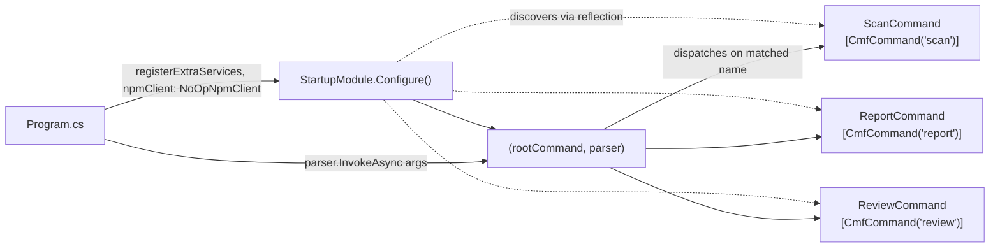
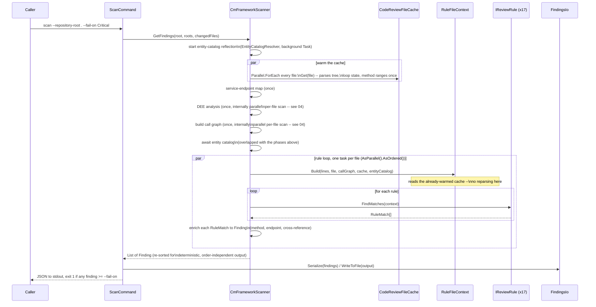
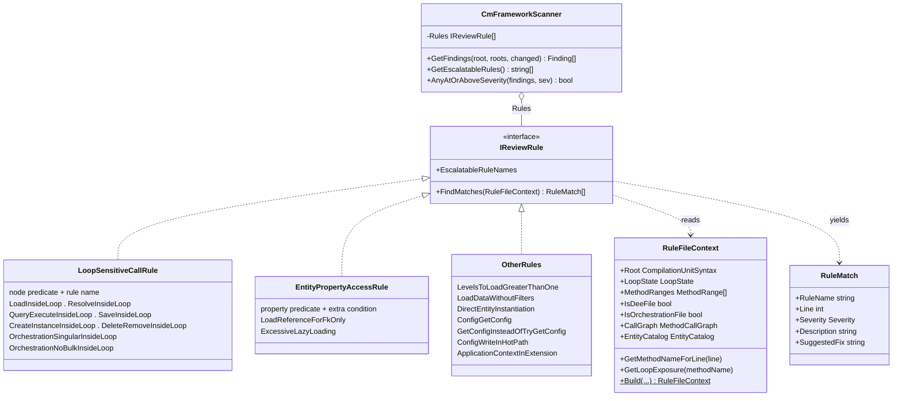
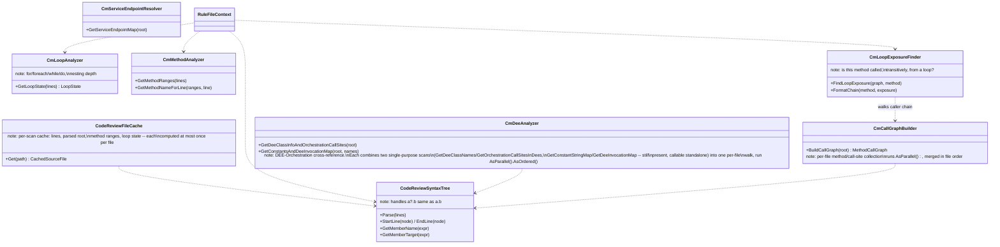

# How the scanner is put together

Four views of the same codebase: how the CLI boots and finds its commands, what happens
end-to-end during a `scan`, how the rule engine is shaped so a new rule is one class, and how
the syntax-analysis layer underneath it all fits together.

## 01 · CLI bootstrap & command discovery

`Program.cs` doesn't build a command tree by hand. It hands control to `Cmf.CLI.Core`'s
`StartupModule.Configure(...)`, which reflects over the assembly for classes carrying a
`[CmfCommand]` attribute, wires each into a `Command`, and returns a ready root command plus
parser.

Dotted arrows are discovery (reflection at startup); solid arrows are the actual dispatch once a
command line is parsed.

## 02 · End-to-end: a `scan` run

Once dispatched, a command's `Execute(...)` method is a thin adapter — the real work is
`CmFrameworkScanner.GetFindings`, which builds one `RuleFileContext` per file and runs every
registered rule against it.

The scan roots (which folders to walk) are discovered from the repository's own `cmfpackage.json`
manifests by `CodeReviewPaths` — Business-package siblings for Orchestration, `contentType: "DEE"`
sources for DEEs — so no project-name convention is hardcoded. The **entity catalog** is resolved by
`EntityCatalogResolver`, which reflects (metadata-only, `MetadataLoadContext`) over the platform
assemblies the repo references (via `project.assets.json`) to classify entity types by base class.
That reflection is independent of source parsing and only feeds the rule loop, so it's kicked off as a
background task up front and awaited just before the loop — hiding its ~1s cost behind the parse phases.
It requires a restored repository; see [commands.md](commands.md) — "Entity catalog".

**Parallelism, and why it's still deterministic.** Parsing dominates scan time, and every phase's
per-file work is independent (each file's own syntax tree, read-only shared state otherwise), so four
separate spots fan out across cores: the cache warm-up (`Parallel.ForEach`), DEE analysis and call-graph
construction (each `.AsParallel().AsOrdered()` internally — see 04), and the main rule loop
(`.AsParallel().AsOrdered()`). `AsOrdered()` plus the final stable `OrderBy`/`ThenBy` on severity/path/line
means a parallel scan and a sequential one produce byte-identical output — parallelism only changes
wall-clock time, never the result. Run with `CODEREVIEW_PROFILE=1` to see each phase's own timing on stderr.

`ReviewCommand` follows the same path and then hands the findings straight to
`ReportCommand.Build`, which renders either Markdown or a self-contained HTML page
(`--report-format`, via `CmReportGenerator` / `CmHtmlReportGenerator`).

## 03 · The rule engine

Every one of the 17 rules implements the same tiny interface. Most don't even need a new class —
`LoopSensitiveCallRule` and `EntityPropertyAccessRule` are reusable, parameterized rules; a
genuinely new pattern gets a small dedicated class instead.

- **`o--`** composition — the scanner owns the fixed list of rule instances.
- **`..>`** dependency — a rule reads context in, yields matches out; it never touches
  enrichment (method name, endpoint, cross-reference) itself.

## 04 · Underneath: the syntax-analysis layer

Everything above is built on real Roslyn syntax trees, not text or regex. One shared parse
helper, five focused analyzers, each answering exactly one question about a file.

`CmFrameworkScanner` builds the call graph, DEE map, and service-endpoint map *once* per run,
then hands them to every per-file `RuleFileContext` — that's why a 17-rule, whole-repo scan
doesn't reparse the world 12 times over. On top of that, every pass (DEE analysis, call graph,
main rule loop) shares one `CodeReviewFileCache` per scan, so a file's text is read, parsed, and
loop/method-analyzed at most once no matter how many passes touch it.

---

**Adding a rule** doesn't touch any of this. It's one more class implementing `IReviewRule` (or
one more instantiation of `LoopSensitiveCallRule` / `EntityPropertyAccessRule` if the shape
already fits), registered in `CmFrameworkScanner.Rules`. See [docs/rules.md](rules.md).

## Process Rule deployment context

`ProcessRuleValidationRule` is registered with the normal built-in rules. After warming the
shared syntax cache, the scanner builds one read-only `ProcessRuleRepositoryContext`: package
content/phase/version classification, same-package MasterData schema changes, and resolvable
entity-type creator/consumer ordering. `RuleFileContext` carries this context into the parallel
rule loop; Process Rule detection reuses the cached Roslyn trees and yields ordinary `RuleMatch`
values. Existing enrichment, configuration, suppression, baseline, and changed-file filters apply.

Deployment metadata comes from repository source/package files. The Markdown authoring guidelines
are implementation reference material and have no runtime role. No language model or policy
interpreter is involved. Findings use the existing JSON, Markdown, and HTML outputs.
